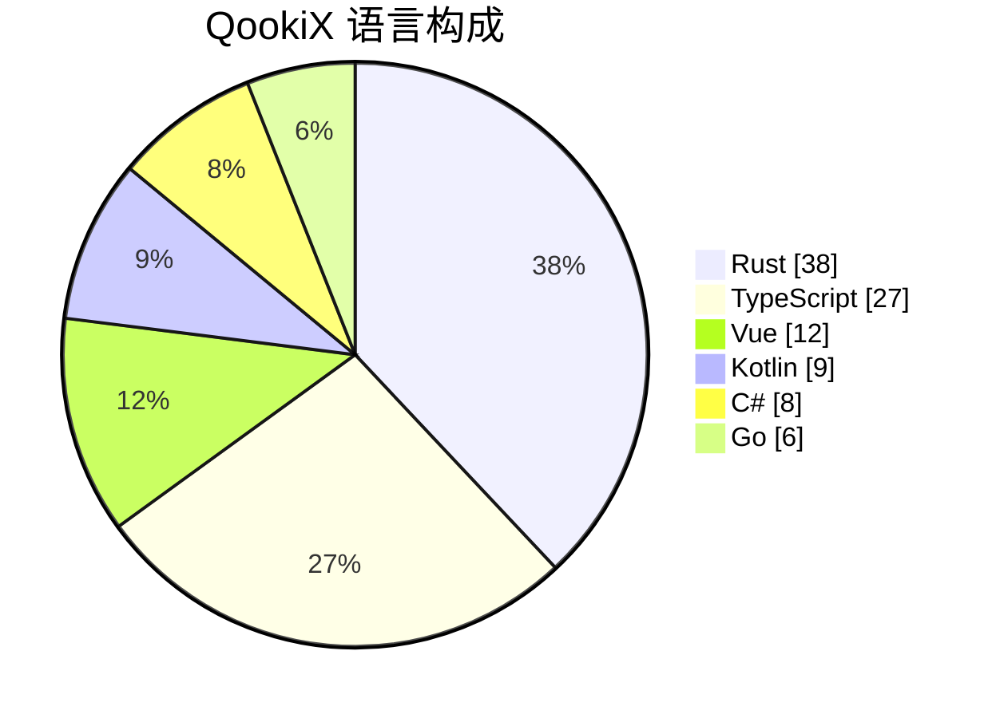

<h1>QookiX</h1>

<strong>把工具做得轻一点，干净一点。</strong>

从一个 Minecraft 启动器起步的开源桌面工具组织

  
  
  

  <a href="https://www.qookix.cn">官网首页</a> ·
  <a href="https://docs.qookix.cn">文档中心</a> ·
  <a href="https://github.com/orgs/QookiX/repositories">全部仓库</a> ·
  <a href="mailto:help@qookix.cn">联系我们</a>

---

## 关于 QookiX

QookiX 是一个围绕「好用的小工具」建立起来的开源组织。起点是 **[QookiX Launcher](https://github.com/QookiX/QookiX-Launcher)** —— 一个安装包仅 7 MB、不含广告与遥测、覆盖 Windows / macOS / Linux / Android 的 Minecraft 启动器。顺着同一套做法，我们把触角伸到了更多日常场景：SSH 客户端、软件宣传片编辑器、局域网快传，以及支撑它们的文档站、翻译服务和更新聚合站。

所有代码都公开在 GitHub，主流项目由 GitHub Actions 自动构建多平台安装包，Issues 与 Pull Request 一律开放。

| 纯净 | 轻量 | 跨平台 | 开源 |
| :--- | :--- | :--- | :--- |
| 不插广告、不做捆绑、不搞遥测；主打产品源码可逐行审查 | 原生技术栈，安装包尽量小、启动尽量快、内存占用尽量低 | Windows / macOS / Linux / Android，桌面端与移动端数据互通 | 以 GPL-3.0 为主，翻译平台为 MIT，具体以各仓库 LICENSE 为准 |

## 组织数据

> 常见统计卡片服务只支持个人账号，组织主页用不了。下面这组数字由本仓库的 [同步任务](https://github.com/QookiX/.github/actions/workflows/update-stats.yml) 每天通过 GitHub API 拉取并写回，不需要手工维护。

<!-- QK:STATS:START -->

  
  
  
  

近 12 周提交活跃度 &nbsp; <code>▂▃▄▆▄▂█▆▃▅▇▄</code>

版式示例数据 · 推送后由 GitHub Actions 自动同步为真实数据

<!-- QK:STATS:END -->

## 项目矩阵

### 主打产品

| 项目 | 做什么 | 技术栈 |
| :--- | :--- | :--- |
| [QookiX-Launcher](https://github.com/QookiX/QookiX-Launcher) | 简洁无广的跨平台 Minecraft 启动器；双源内容中心、皮肤中心、云存档同步、版本隔离、多账号管理 | Tauri 2 · Rust · Vue 3 |
| [QookiX-Launcher-Android](https://github.com/QookiX/QookiX-Launcher-Android) | 启动器安卓原生版，触控优化，与桌面端共享账号、实例配置与模组列表 | Kotlin |
| [QookiT](https://github.com/QookiX/QookiT) | 现代化轻量级 SSH / SFTP 桌面客户端；可拖拽面板工作区、终端、远程文件管理与性能监控 | Tauri 2 · Rust · React |
| [QookiV](https://github.com/QookiX/QookiV) | 面向软件宣传片的桌面视频编辑器；时间线 + 所见即所得预览 + 模板化导出 MP4 / 独立网页 | Tauri 2 · React · Canvas |
| [QookiL](https://github.com/QookiX/QookiL) | 局域网快传：电脑开服务，手机浏览器扫码即可互传文件，对方无需安装任何软件 | C# · WinUI 3 · Kestrel |

### 配套项目

| 项目 | 做什么 | 技术栈 |
| :--- | :--- | :--- |
| [Qookix-Translate-Platform](https://github.com/QookiX/Qookix-Translate-Platform) | Launcher 官方翻译服务后端，支持自托管 | Go · MIT |
| [QookiX-Docs](https://github.com/QookiX/QookiX-Docs) | 官网与使用文档站（含多语言） | Nuxt · VitePress · Vue |
| [QookiW-WhatsNew](https://github.com/QookiX/QookiW-WhatsNew) | 「出炉日志」：全组织仓库的 CHANGELOG 与提交记录，一炉端出 | React · Vite |
| [QookiX-Video](https://github.com/QookiX/QookiX-Video) | 启动器宣传视频的源码 | HTML |
| [.github](https://github.com/QookiX/.github) | 组织简介与公共配置（也就是这里） | Markdown |

## 技术栈与平台

**Tauri 2 + Rust** 是主力底座，界面交给 **Vue 3 / React 19 + TypeScript**；安卓端用 Kotlin，Windows 原生端用 C# + WinUI 3，服务端用 Go。官网（Nuxt）与文档站（VitePress）分开部署在 Vercel。

### 语言构成

<!-- QK:LANG:START -->

| 语言 | 占比 |
| :--- | ---: |
| Rust | 38% |
| TypeScript | 27% |
| Vue | 12% |
| Kotlin | 9% |
| C# | 8% |
| Go | 6% |

按各仓库 languages 接口字节数聚合 · 每日自动同步

<!-- QK:LANG:END -->

### 平台覆盖

| 项目 | Windows | macOS | Linux | Android |
| :--- | :---: | :---: | :---: | :---: |
| QookiX-Launcher | ● | ● | ● | ○ |
| QookiX-Launcher-Android | ○ | ○ | ○ | ● |
| QookiT | ● | ● | ● | ○ |
| QookiV | ● | ● | ● | ○ |
| QookiL | ● | ○ | ○ | ○ |

● 已支持 · ○ 暂未覆盖。平台支持属于产品事实，变更时手动更新此表；其余数据每天自动同步。

## 参与进来

- **反馈问题**：软件 Bug / 功能建议 → 对应仓库的 [Issues](https://github.com/orgs/QookiX/repositories)；文档错漏、官网显示问题 → [QookiX-Docs](https://github.com/QookiX/QookiX-Docs/issues)。
- **改文档**：打开任意文档页，点底部「在 GitHub 上编辑此页」，网页里直接提交 PR，不用装环境。
- **提代码**：先读目标仓库的 `CONTRIBUTING.md`，提交前跑一遍本地构建／类型检查。
- **其它合作与建议**：<help@qookix.cn>。

---

免费 · 开源 · 无广告

 

<a href="https://www.qookix.cn">官网首页</a> · <a href="https://docs.qookix.cn">文档中心</a> · <a href="https://github.com/orgs/QookiX/repositories">全部仓库</a> · <a href="mailto:help@qookix.cn">联系我们</a>

